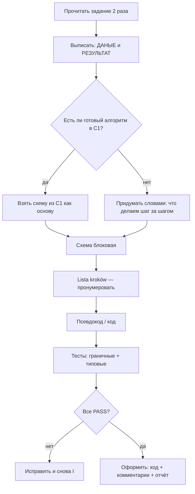
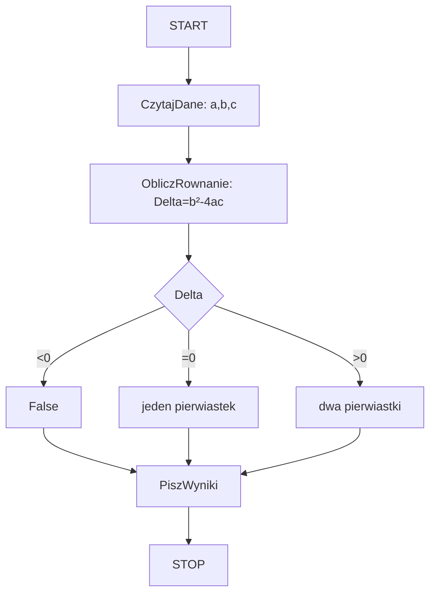

# AiSD — от А до Я: как самому решать задания C1, C2, C3

Личное руководство. Не для преподавателя.
Источники: методички `AiSD cz.1 v.3.8.pdf` (192 стр.), `AiSD_2 Wstęp do programowania`, `AiSD4_w1 Pascal`, `AiSD4_w3 Python`, и задания `AiSD_C1_60`, `AiSD_C2_60`, `AiSD_C3_51` (Bohdan Szymczak).

---

## ЧАСТЬ 0. Куда смотреть и чем пользоваться

### Материалы (в папке OneDrive)
| Файл | Зачем |
|---|---|
| `AiSD cz.1 v.3.8.pdf` | **Главная теория**: определение алгоритма, схемы блоковые, рекурсия/итерация, silnia, potęga, złożoność. Читать выборочно: стр. 10–22 (algorytm + schemat), 61–68 (iteracja/rekurencja), 132–135 (złożoność). |
| `AiSD_2 Wstęp do programowania v.03.pdf` | Синтаксис Pascal/Python, переменные, типы, pętle, warunki. |
| `AiSD4_w1. Wprowadzenie_do_Pascala cz.1.pdf` | Первый консольный проект в Lazarus: `program`, `begin..end.`, `writeln`, `readln`, F9, процедуры/функции, передача через wartość/>var. |
| `AiSD4_w3. Wprowadzenie_do_Pythona.pdf` | IDLE, `input()`, `float()`, `print()`, N-е функции, кортежи, пример równania kwadratowego. |
| `AiSD_C1_60.pdf` / `C2_60` / `C3_51` | Сами задания — читать ДО того, как писать код. Там же требования к выводу. |

### Полезные ссылки (из методичек)
- Lazarus: https://www.lazarus-ide.org/ · документация https://wiki.freepascal.org/ · форум https://forum.lazarus.freepascal.org
- Python: https://www.python.org/doc/ · https://pl.wikibooks.org/wiki/Zanurkuj_w_Pythonie
- Схемы: LibreOffice Draw/Writer или https://app.diagrams.net/

### Инструменты
- **Pascal**: Lazarus (у тебя установлен: `C:\Lazarus`). Компиляция F9. ВISION console: **без польских диакритиков**.
- **Python**: IDLE или `python3` в терминале. У тебя 3.14.9.
- **Схемы**: Graphviz `dot` (у меня), или вручную в Draw. Условные обозначения — из стр. 18 методички:
  - овал = Start/Stop; параллелограмм = ввод/вывод; прямоугольник = операция/вычисление; **ромб = условие**; стрелки = направление.
- **Тесты**: отдельный файл `run_all_tests.py` + сохранённый вывод `test_results.txt`.

---

## ЧАСТЬ 1. Теория, которую надо знать (минимум)

### 1.1 Что такое алгоритм (дословно из методички, стр. 11)
> **Algorytm** – ciąg precyzyjnie zdefiniowanych i jednoznacznych kroków prowadzących do wykonania określonego zadania.

**6 cechs правильного алгоритма:**
1. określony stan początkowy — есть точка старта;
2. skończona liczba operacji — обязательно закончится;
3. uniwersalny — работает для класса задач, не для одного случая;
4. jednoznaczny — никаких двух трактовок;
5. efektywny — завершается за разумное время;
6. wyróżniony koniec — явно обозначенный Stop.

Это прямо спрашивают в **C1 Zadanie 3 п.3** («Przedyskutuj poprawność treści zadania pod kątem definicji algorytmu»). Ответ: в задании не оговорены ujemne и zero — надо явно принять `L=|L|` и `S(0)=0`, иначе алгоритм неjednoznaczny.

### 1.2 Три способа записи алгоритма
1. **Język naturalny** — словами («сначала прочитай число, потом...»).
2. **Lista kroków** — нумерованный список (Krok 1, Krok 2, ...).
3. **Schemat blokowy** — графика. C1 требует все три.

**7 правил схемы (стр. 19):**
1. блоки соединяются стрелками по направлению;
2. блок = ciąg operacji;
3. блок выполняется целиком;
4. следующие операции не зависят от предыдущих, если dependence не передана через zmienne;
5. в каждый блок ведёт **не более одной линии**;
6. порядок задан линиями;
7. линии могут сливаться, но **не разветвляться** (кроме ромба-условия).

Типовая структура (стр. 22): `Start → Wprowadzanie danych → Algorytm → Wyprowadzanie wyników → Stop`.

### 1.3 Переменные, типы, арифметика
- **Pascal:** `integer` (целое), `real` (дробное), `int64` (большое целое — для 18!), `boolean` (логический). `mod` — остаток, `div` — целочисленное деление.
- **Python:** `int`, `float`, `bool`; `%` — остаток, `//` — целочисленное деление, `**` — степень.
- **Важно:** `mod`/`%` и `div`/`//` — основа заданий Z3 (сумма цифр) и Z2 (високосный год).

### 1.4 Условия и разгаłowania
- Pascal: `if ... then ... else ...`, `begin..end` для нескольких операций.
- Python: `if ...: ... elif ...: ... else: ...`, блоки по отступу.
- В C1 Z2 условие високосного года: `(R mod 4 = 0 and R mod 100 <> 0) or (R mod 400 = 0)`.

### 1.5 Циклы (iteracja)
> **Iteracja** (łac. iteratio — повторение) — wielokrotne powtarzanie ciągu czynności w pętli, dla zadanej liczby razy lub do spełnienia warunku. (стр. 62)

- Pascal: `for i := 1 to n do`, `while warunek do begin ... end`.
- Python: `for i in range(n):`, `while warunek:`.
- **Ловушка:** плохо сформулированный warunek → nieskończona iteracja (зацикливание). Всегда проверяй, что переменная цикла изменивается.

### 1.6 Рекурсия
> **Rekurencja** — zdefiniowanie pojęcia za pomocą tego samego pojęcia; wywołanie funkcji внутри её же тела. (стр. 63)

Обязательные два элемента:
1. **warunek bazowy** (np. `n=0 → 1`) — без него бесконечный вызов;
2. **krok rekurencyjny** (`n! = n · (n−1)!`).

Каждое вызов алocate в памяти локальные zmienne и адрес возврата на **stos**. При большом n — przepełnienie stosu. Отсюда Derekursywacja (перевод в итерацию), стр. 65.

### 1.7 Сложность (złożoność obliczeniowa)
> Złożoność obliczeniowa = ilość środków koniecznych do wykonania algorytmu (čas + pamięć). (стр. 133)

**Czas работы программы НЕ является мерой сложности** — влияют CPU, ОС, язык, другие процессы (стр. 134–135). Смотри на **liczbę operacji** в зависимости od n:
- suma kwadratów — O(n);
- silnia iteracyjna — O(n) (n−1 mnożeń);
- silnia rekurencyjna — O(n), но с narzutem wywołań;
- potęga通过 kwadratowanie — **O(log₂ n)** (15 mnożeń → 7).

### 1.8 Погрешность и тестирование
- Тест = **analiza → scenariusze testowe → wykonanie → porównanie z oczekiwanym wynikiem**. Именно так требует каждое задание C1/C2/C3.
- Граничные przypadki (wartości graniczne) — самые важные: n=0, L=0, год 1900/2000, час 13:00/15:00, Δ=0.
- Если интерфейс недоступен — stub/mock, т.е. подставить известный сигнал (sin(t)) и фиксированную дату.

---

## ЧАСТЬ 2. Алгоритм решения ЛЮБОГО задания (универсальный)



Тот же алгоритм текстом:
1. Выйди из задания **Dane wejściowe** и **Wynik**. Запиши их буквально (L0, n, S...).
2. Проверь, не ссылается ли задание на предыдущее («Algorytm z Zadania 1 Ćwiczenia 1») — então переиспользуй.
3. Нарисуй схему **до кода**. Ромб — только для условия.
4. Напиши listę kroków по схеме — один блок = один шаг.
5. Напиши код, разбив на функции (4–5 штук, как требует задание).
6. Придумай **минимум 4 теста**: 1 типовой, 2 граничных, 1 нестандартный (отрицательный/ноль).
7. Запусти, сравни с ожидаемым, сохрани вывод в файл.
8. В отчёте напиши: analiza → scenariusze → wyniki → wnioski.

---

## ЧАСТЬ 3. Как делать каждое задание конкретно

### C1 — просто алгоритмы (без кода!)
Формат одной страницы задания:
```
Temat: ...
Dane wejściowe: ...
Wynik: ...
1. Schemat blokowy  (рисунок)
2. Lista kroków     (1..7)
3. Test poprawności (analiza, scenariusze, tabela wyników)
4. (где просят) algorytm alternatywny / dyskusja definicji
```

| Zadanie | Суть | Ключевое |
|---|---|---|
| 1 | S=∑(L0+i)² |累加 в цикле; альтернатива — формула O(1) |
| 2 | rok przestępny | `%4==0 and %100!=0 or %400==0` |
| 3 | suma cyfr | `S+=L%10; L=L//10`; обсудить definicję algorytmu |
| 4 | licznik prądu | taryfa I = 6–13, 15–22; энергия = moc/3600; max moc месяца |
| 5 | najszybsze połączenie | минимум czynności: oddzwoń → ulubiony → książka → klawiatura |
| 6 | robot | kolumny, krok 0,75 m, wyjście (22, 6), omijanie zajętych pól |

### C2 — implementacja (Pascal **или** Python)
Обязательное требование: **программа не может быть одним блоком** — поделить на 4功能和:
```
a) funkcja czytająca dane
b) funkcja obliczająca
c) procedura wypisująca
d) procedura sterująca (wywołuje pozostałe)
```
Пример для równanie kwadratowego:



Kod (Python, шаблон из методички AiSD4_w3):
```python
import math

def czytaj_dane():
    return float(input("a=")), float(input("b=")), float(input("c="))

def oblicz(a, b, c):
    d = b*b - 4*a*c
    if d < 0:
        return None
    return ((-b-math.sqrt(d))/(2*a), (-b+math.sqrt(d))/(2*a))

def pisz(wynik):
    if wynik is None:
        print("Brak rozwiazan")
    else:
        print("x1={:.2f} x2={:.2f}".format(*wynik))

def run():
    pisz(oblicz(*czytaj_dane()))
```

**Pascal-аналог:** `program X; uses CRT, math, sysUtils;` + `{$mode objfpc}` первой строкой (иначе `Result` не компилируется), `readln` в конце чтобы консоль не закрылась.

### C3 — rekurencja i iteracje (ОБА языка!)
| Zadanie | Что сделать | Что сравнить |
|---|---|---|
| 1 | silnia 18两种方法 |一致的 wynik, kolumny wyrownane |
| 2/3 | zmierzyć czas 18!, 10 000 000 wywołań | Pascal `Time*24*60*60`; Python `datetime.today()`; объяснить разницу |
| 4 | suma cyfr rekurencyjnie | iteracyjna vs rekurencyjna, który код krótszy/czytelniejszy |
| 5 | potęga a=2, n=0..15 | 4 метода + licznik mnożeń; zwykła O(n) vs kwadratowanie O(log n) |

**Шаблон замерa времени (Python, дословно из методички):**
```python
from datetime import datetime
t0 = datetime.today()
for i in range(n_powtorzen):
    Silnia(n)
t1 = datetime.today()
t = t1 - t0
t = t.seconds + t.microseconds*0.000001
```

**Результаты, которые у нас получились (реальные):**
- Python 1 mln powtórzeń 18!: iteracyjna **1.35 s**, rekurencyjna **2.86 s**.
- Pascal 100 tys.: **0.005 s / 0.009 s**.
- Mnożenia dla `2^n`, n=15: zwykła **15**, z kwadratowaniem **7**.

---

## ЧАСТЬ 4. Частые ошибки (и как их не делать)

| Ошибка | Почему | Лечение |
|---|---|---|
| `status_weryfikacji=P`, а сумма 5,02 | В campo podstawa вписано 55,80 вместо **620,00** | Всегда проверяй `X.05=620`, `IX.02=55,80` руками (это к NFZ, но та же логика: OK badge ≠ правильно) |
| Пустая DRA принимается | ePłatnik не проверяет суммы | Сверяй цифры глазами |
| RCA вместо только DRA | Не отмечена галочка «Płatnik opłaca składki wyłącznie za siebie» | Пересоздать komplet с галочкой |
| `Result` не компилируется в Pascal | Нужен режим objfpc | `{$mode objfpc}` первой строкой |
| Бесконечная рекурсия | Нет warunku bazowego | `if n=0 then Result:=1` |
|细化 Nieprawidłowe wyniki при n=0 | Не обработан граничный случай | Тест n=0 обязателен |
| Зацикливание в while | Не меняется переменная условия | Каждая итерация должна приближать к выходу |

---

## ЧАСТЬ 5. Готовые схемы (в репозитории)

Все 6 схем C1 в `C1_schematy/diagrams/` (SVG + PDF) и исходники DOT в `C1_schematy/source/`. Открой PDF — там те же блоки, что описаны здесь.

Кратко главная схема (шаблон любой программы):
```
   Start
     |
  Wczytaj dane
     |
  Inicjalizacja (S:=0, i:=0)
     |
  <warunek?> ---nie--> Wypisz wynik ---> Stop
     | tak
  Oblicz / inkrementuj
     |
     (возврат к warunek)
```

---

## ЧАСТЬ 6. Что уметь в итоге (чеклист)

- [ ] Объяснить 6 cech algorytmu своими словами
- [ ] Нарисовать схему с ромбом-условием и стрелками без разветвления линий
- [ ] Перевести схему в listę kroków и в код
- [ ] Разбить программу на 4–5 функций (ввод → расчёт → вывод → sterowanie)
- [ ] Написать тест с граничными значениями и объяснить результат
- [ ] Объяснить разницу iteracja / rekurencja и почему rekurencja медленнее
- [ ] Посчитать liczbę mnożeń: O(n) против O(log n)
- [ ] Запустить Pascal в Lazarus (F9) и Python в IDLE (F5)
- [ ] Не использовать polskie znaki в консоли Pascal

---

## Приложение: где что лежит в репозитории
`https://github.com/Kiril-dev-wizard/AiSD.git`
- `docs/AiSD_C1.md/.pdf`, `AiSD_C2.md/.pdf`, `AiSD_C3.md/.pdf` — готовые решения
- `C1_schematy/` — 6 схем SVG/PDF + DOT
- `C2_python/`, `C3_python/` — код + `test_results.txt`
- `C2_pascal/`, `C3_pascal/` — код Pascal + `pascal_test_results.txt`
- `INSTALL.md` — как ставить инструменты
